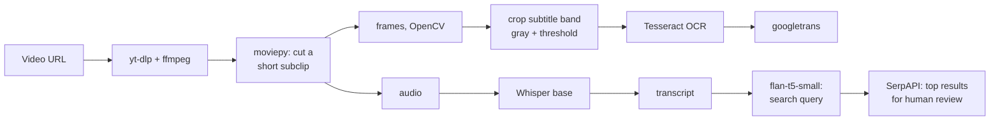

# Multimodal Media-to-Text Pipeline

**Turning short videos into text with speech recognition (Whisper), on-screen text recognition (Tesseract), translation and source search, run end to end on real social-media clips, with each stage's actual output, including the ones that failed.**

[](https://colab.research.google.com/github/dojedaro/multimodal-media-to-text-pipeline/blob/main/multimodal_media_to_text_pipeline.ipynb)
[](https://github.com/dojedaro/multimodal-media-to-text-pipeline/actions/workflows/notebooks.yml)

## Results: what each stage produced

Input: two short public clips of a Canadian political interview, downloaded with `yt-dlp`.

| Stage | Tool | Output on the real clip | Verdict |
|---|---|---|---|
| Speech to text | Whisper `base` (CPU) | A full, readable transcript of the clip | **Works.** Proper names suffer: "Poilievre" came out as "Polly Ev" |
| On-screen text | OpenCV crop of the subtitle band, grayscale + threshold, Tesseract | One word: "now" | **Failed.** Burned-in captions on moving video defeat a fixed crop and a fixed threshold |
| Translation | `googletrans` | "now" → "조선민주주의인민공화국" ("Democratic People's Republic of Korea") | **Failed badly**, and silently. The unofficial client returns confident nonsense |
| Search query | `flan-t5-small` | Echoed the transcript back instead of a query | **Failed.** The model is too small to follow the instruction |
| Source search | SerpAPI (Google) | Top result: the speaker's own Facebook post repeating the claim | **Works as search, fails as verification.** The best match for a claim is often its source |

**What this taught me:** the pipeline ran without a single error, yet three of five stages produced
garbage. Each stage needs its own check (OCR confidence, a back-translation test, a query that
must be shorter than its input, a "does the source differ from the speaker?" rule) instead of
trusting that a run that finished is a run that worked.

## How it works



## Run it

Runs on Google Colab; `ffmpeg` and `tesseract-ocr` are system packages the first cell installs with
`apt`.

```bash
pip install -r requirements.txt
jupyter notebook multimodal_media_to_text_pipeline.ipynb
```

The search stage needs a SerpAPI key, which the notebook asks for with `getpass`.

## Stack

Python, OpenAI Whisper, OpenCV, Tesseract (pytesseract), moviepy, yt-dlp, Hugging Face Transformers
(Flan-T5), googletrans, SerpAPI.

## Next steps

- OCR: detect text regions (EAST or PaddleOCR) instead of a fixed crop, and keep only results above a
  confidence threshold.
- Translation: an official API or an open model such as NLLB, plus a back-translation sanity check.
- Replace Flan-T5-small with an instruction-following LLM for query writing, and rank sources by
  independence from the speaker, not just relevance.

## License

MIT
